<div align="center">


<a href="#-the-story">
  
</a>

<br/>


<br/>

<a href="https://mostafa7arafa.github.io/rls-graduation-day/"></a>

<sub>Desktop or phone · keyboard, touch, or Xbox / PlayStation controller · no install</sub>

<br/><br/>

<a href="https://mostafa7arafa.github.io/rls-graduation-day/">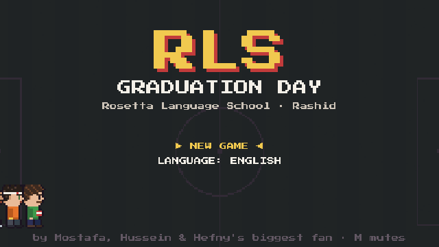</a>

<br/>

*A top-down comedy RPG in the spirit of Undertale and Pokémon, about three real friends
who spent twelve years at the same school and are about to leave it for the last time.*

</div>

---

## 🎓 The story

It's graduation day at **Rosetta Language School**. Mostafa, Hussein and Mohamed Hefny try to walk out of the gate one last time, and find it chained shut with a note:

> *"No student leaves with unfinished business."*

To get out they need a **clearance form** (إخلاء طرف) signed by every department. That means facing every teacher they ever drove crazy. You can't beat a teacher. **You win them over.**

<div align="center">
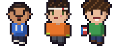

| | Mostafa | Hussein | Mohamed Hefny |
|---|---|---|---|
| **Look** | buzz cut, blue hoodie | bandaged head, keeper gloves | huge curly hair, books |
| **Superpower** | fixes any laptop, googles anything | saves penalties with his face | gets top marks |
| **Weakness** | checks his phone at the worst moment | Nour | gets angry |

</div>

**Swap the leader at any time** (`TAB` / `RB` / `R1`). Every NPC, object and teacher reacts differently depending on who's in front. That's the core comedy mechanic: the same door has three different jokes.

---

## 🕹️ Seven chapters, seven different games

Each teacher is a different mini-game. No two chapters play the same.

| | Teacher | Game |
|:-:|---|---|
| **1** | Mr Hassan | Undertale-style encounter: **ACT** with each friend, **dodge** chalk rain, show **MERCY** when he's calm |
| **2** | Sheikh Nasser | A **quiz** where the right answer is whatever *he* believes. Lifelines backfire |
| **3** | Mr Yasser | **Spelling rain**: catch the correct words, dodge the misspellings |
| **4** | Mr Abdo & Mr Ahmed Rezk | **Lab mixing**: two teachers shouting opposite instructions. Hefny goes in alone |
| **5** | Mr Abdelkareem | **Haggling**: he sells his signature as a "private lesson", paid in ful sandwiches |
| **6** | Mr Amr | **Rhythm** push-ups on a darbuka beat |
| **7** | Karim | **Penalty shootout** in first-person, Hussein in goal, Nour watching |
| 🎤 | Aly & Karim Ebid | **WHO IS DUMBER?!**, a game show: TRUE or NONSENSE? |
| 📸 | Mr Mahmoud | **The class photo**: everyone keeps ruining it |

<table>
<tr>
<td>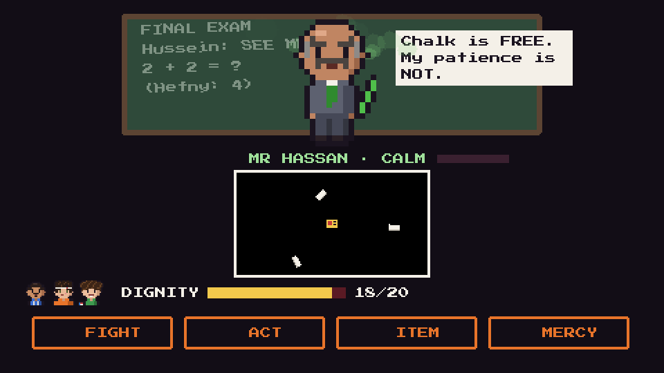</td>
<td>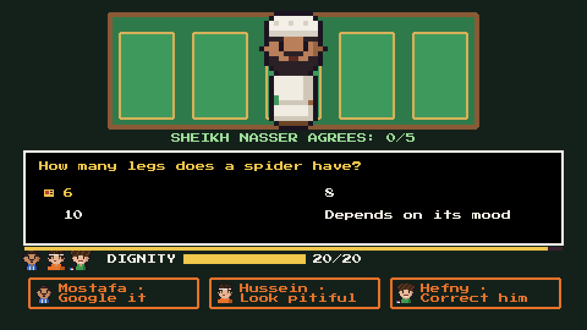</td>
<td>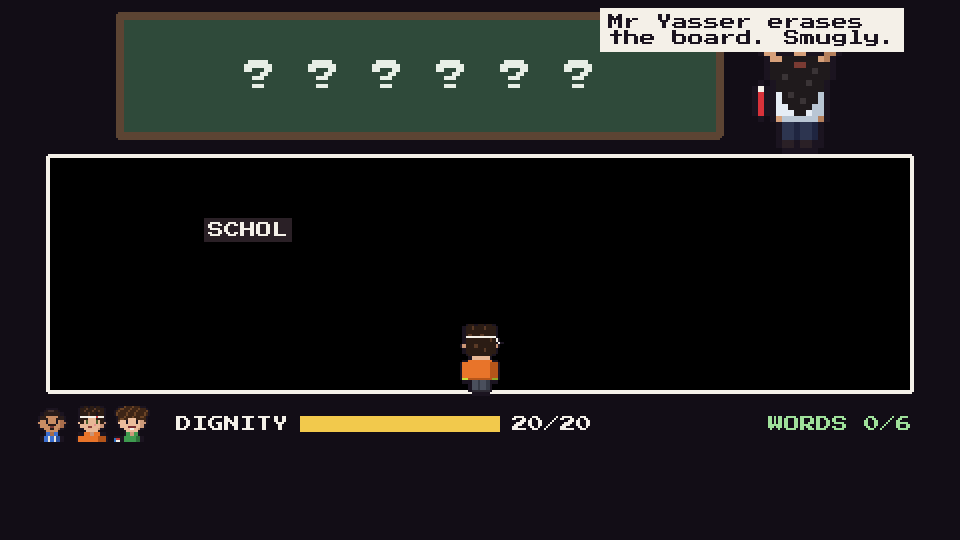</td>
</tr>
<tr>
<td align="center"><sub>Ch1 · Mr Hassan's chalk rain</sub></td>
<td align="center"><sub>Ch2 · "How many legs does a spider have?"</sub></td>
<td align="center"><sub>Ch3 · Spelling rain</sub></td>
</tr>
<tr>
<td>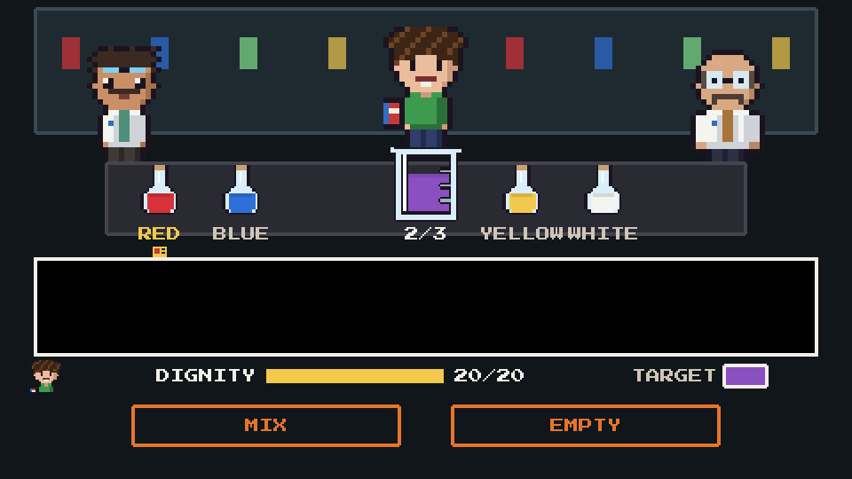</td>
<td>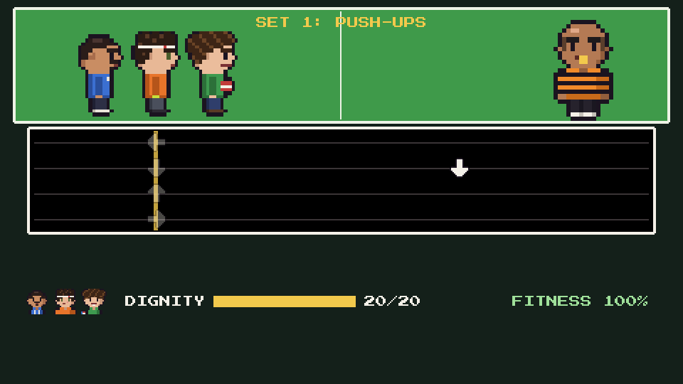</td>
<td>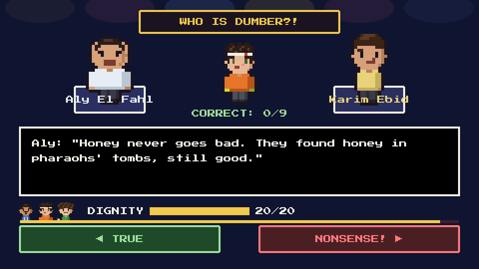</td>
</tr>
<tr>
<td align="center"><sub>Ch4 · The lab</sub></td>
<td align="center"><sub>Ch6 · Push-ups on the beat</sub></td>
<td align="center"><sub>WHO IS DUMBER?!</sub></td>
</tr>
<tr>
<td>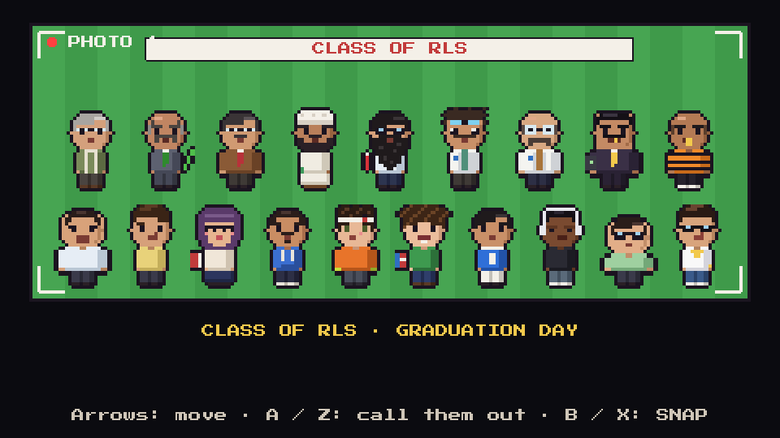</td>
<td>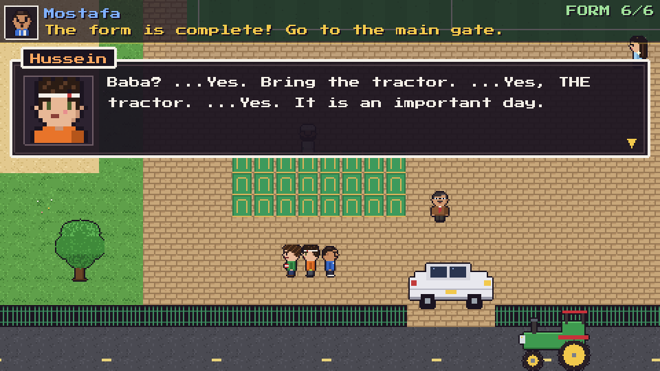</td>
<td>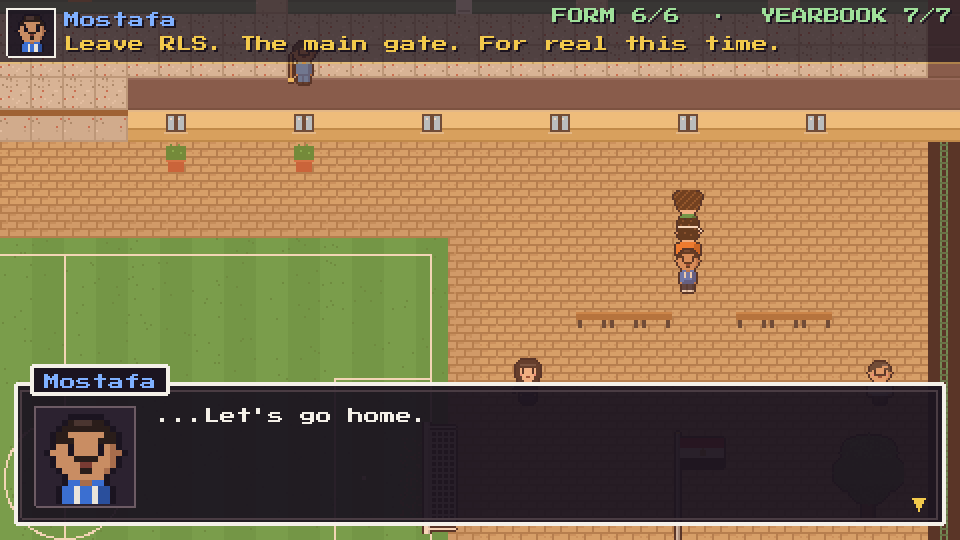</td>
</tr>
<tr>
<td align="center"><sub>The class photo</sub></td>
<td align="center"><sub>Baba? ...Bring the tractor.</sub></td>
<td align="center"><sub>One last time on the bench</sub></td>
</tr>
</table>

---

## 🏫 The school is full of people

<div align="center">
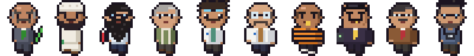
<br/><sub>The teachers</sub>
<br/><br/>
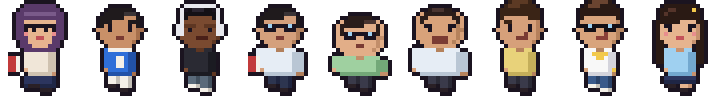
<br/><sub>The class</sub>
</div>

- 📖 **The yearbook**: find your classmates around the school and get them to sign it. Their signatures change the graduation ceremony and the end credits.
- 🪑 **Bench talks**: between chapters, the three sit on the court bench and talk about what comes next.
- 🧹 **Background people**: the doorman still has Hussein's shoe from 2017.

---

## 🌍 Two languages

The whole game is playable in **English** and **Egyptian Arabic (مصري)**. The Arabic is an adaptation, not a translation: the jokes are rewritten in Masri. Over 1,000 lines, right-to-left layout included.

<div align="center">
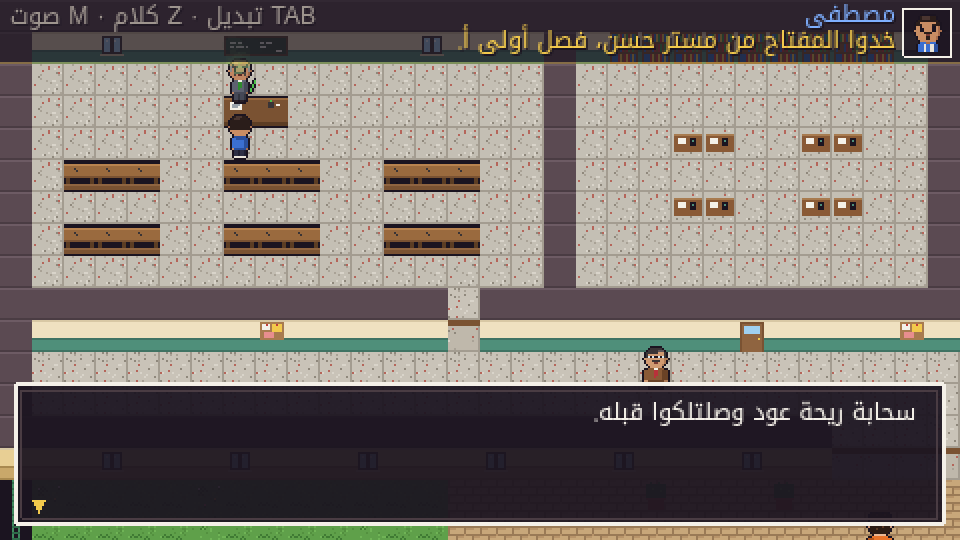
</div>

---

## 🎮 Controls

| Action | Keyboard | Xbox | PlayStation | Phone |
|---|:-:|:-:|:-:|:-:|
| Walk | Arrow keys | D-pad / left stick | D-pad / left stick | on-screen pad |
| Talk, confirm | `Z` | A | ✕ | A (or tap) |
| Back | `X` | B | ○ | B |
| Run | `Shift` | X / RT | □ / R2 | hold RUN |
| Swap leader | `Tab` | LB / RB | L1 / R1 | SWAP |
| Pause menu | `Esc` | Start | Options | MENU |

The pause menu changes the language, toggles sound, and goes back to the title screen (progress is saved).

Plug a controller in at any time. The on-screen hints switch to your controller's buttons. On a phone, hold it sideways; on Android it goes fullscreen, and on iPhone use **Share → Add to Home Screen** for fullscreen.

---

## 🚀 Run it

**Just play:** https://mostafa7arafa.github.io/rls-graduation-day/

Or run it locally:

```bash
git clone https://github.com/mostafa7arafa/rls-graduation-day.git
cd rls-graduation-day
npm install
npm run dev        # → http://localhost:5173
```

<details>
<summary><b>More commands</b></summary>

| Command | What it does |
|---|---|
| `npm run build` | Typecheck and production build in `dist/` (static, host it anywhere) |
| `npm run art` | Re-bake all pixel art from `tools/art/` into `public/assets/` |
| `node tools/playtest.mjs full` | Headless playthrough with screenshots in `tools/preview/playtest/` (needs the dev server) |
| `LANG=ar node tools/playtest.mjs full` | Same, in Arabic |
| `node tools/i18n-check.mjs` | Lists English lines that are missing an Arabic translation |

</details>

---

## 🛠️ How it's made

- **Every sprite is hand-authored pixel by pixel in code** (`tools/art/*.mjs`) and baked to PNGs. No pixel is drawn at runtime.
- **No audio files.** The music is chiptune written as note strings using Arabic maqam scales and a darbuka. The character voices are synthesised grunts (`src/systems/music.ts`, `src/systems/sfx.ts`).
- **The story is a screenplay.** Each chapter is one file of async scripts (`src/data/story/chN.ts`). Dialogue, quests and the world changing over the day all live there.
- **Automated playtests** drive the whole game in a headless browser (keyboard and simulated controller), take screenshots and check every chapter can be finished.
- Phaser 4 + TypeScript + Vite. One runtime dependency.

<details>
<summary><b>Project layout</b></summary>

```
src/
├── data/
│   ├── story/      chapter scripts, classmates, bench talks, background people
│   ├── ar/         Egyptian Arabic, line by line
│   ├── map.ts      the school floors as ASCII
│   └── cast.ts     names, portraits, voices
├── scenes/
│   ├── WorldScene.ts       the overworld
│   ├── BattleScene.ts      Mr Hassan's encounter
│   ├── encounter/          one mini-game per chapter
│   └── CreditsScene.ts
└── systems/        save, music, sfx, gamepad, i18n
tools/
├── art/            the pixel art, as code
└── playtest.mjs    headless playthroughs
```

</details>

---

<div align="center">

*Made for Hussein and Hefny. Twelve years, one school, and a red tractor.*


</div>
